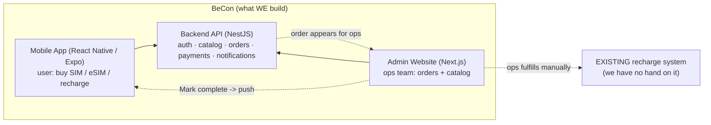
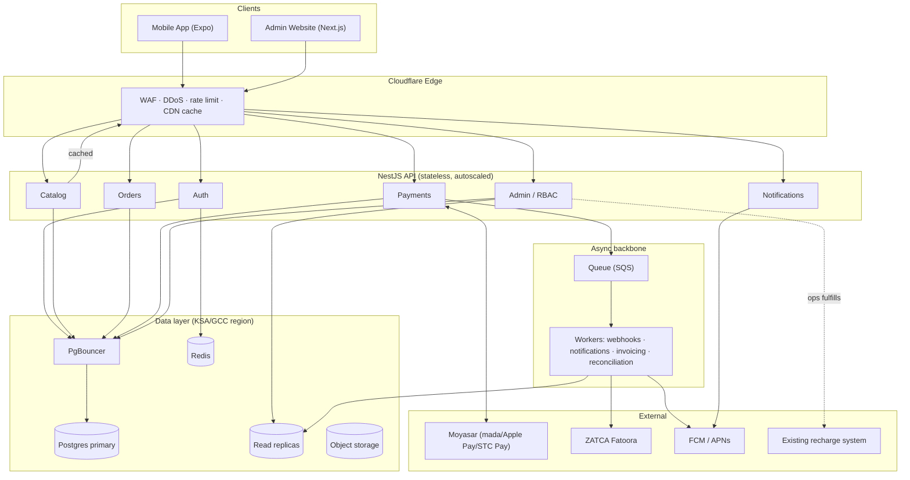
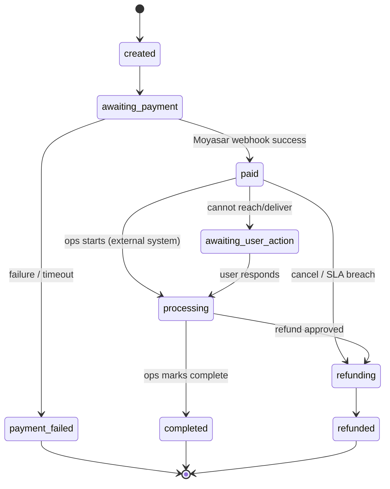
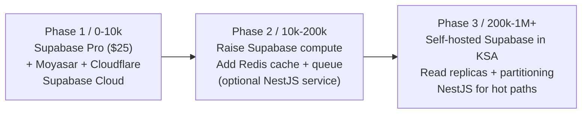

# BeCon — Technical Architecture

**Product:** Mobile app to buy SIM, buy eSIM, and recharge plans for the Saudi Arabian market.
**Scope:** BeCon handles **order intake, payment, handoff, and status tracking**. The actual recharge/SIM fulfillment is done in an **existing separate system** that we do not build (ops performs it manually for now).
**Scale target:** 500,000 registered users within the first month; designed to grow toward 1M+.
**Last updated:** 8 June 2026

---

## 1. What we build vs. what we don't



- **We build:** mobile app, backend API, admin website, payment integration, notifications.
- **We do NOT build:** the recharge/SIM provisioning engine. Ops reads a paid order on the admin website, performs the recharge in the existing system, then clicks **"Mark complete"**, which pushes a notification to the user.
- The two systems are linked today by **a human + the admin dashboard**. A direct API integration can be added later without changing the architecture.

---

## 2. Technology decisions (and the Firebase question)

### Will we use Firebase?
**No — not as our backend or database. Yes — only for push notifications (FCM).**

| Concern | Firebase as primary backend | Verdict |
|---|---|---|
| PDPL data residency | Firestore data lives in Google regions; no in-Kingdom (KSA) residency | ❌ Dealbreaker |
| Payment transaction integrity | NoSQL is weak for strict order+payment ACID transactions | ❌ Wrong tool |
| Reporting / analytics | Complex queries are painful & costly on Firestore | ❌ |
| Vendor lock-in at scale | Unpredictable cost spikes, hard migration | ⚠️ Risk |
| **Push notifications (FCM)** | Only stores device tokens, industry standard, free | ✅ **Use it** |

**Decision:** FCM (+ APNs) for push only. All business data and logic live on **Supabase (PostgreSQL)** in a KSA/GCC region.

### Chosen stack — minimal, Supabase-first

The core stack is intentionally **2 tools**: **Supabase** (backend) + **Moyasar** (payments). Everything else is optional/added later as we grow.

| Layer | Choice | Why |
|---|---|---|
| Mobile app | **React Native (Expo)** | Native eSIM install, push, biometric login, Apple Pay/STC Pay SDKs; shares TypeScript |
| **Backend (all-in-one)** | **Supabase** | PostgreSQL + Auth (Google/Apple/email/guest) + storage + realtime + auto APIs — replaces Firebase, but SQL & not locked-in |
| Database | **PostgreSQL** (via Supabase) | ACID transactions for orders/payments; rich queries for analytics; scales by raising the compute tier |
| Admin website | **Next.js** (separate web app) | Server-rendered dashboard for ops; talks to Supabase with an admin-scoped key |
| Payments | **Moyasar** | mada, Apple Pay, STC Pay, Visa/Mastercard — the KSA part Firebase/Supabase can't do |
| Push notifications | **FCM + APNs** | Order status updates (only Firebase product we use) |
| Server-side logic | **Supabase Edge Functions** | Payment webhooks, order state transitions, invoicing — no separate server needed at first |
| Invoicing | **ZATCA (Fatoora)** integration | Mandatory KSA e-invoice + 15% VAT |
| Auth | **Supabase Auth** (JWT + Google/Apple/email) | Guest browsing, sign-up only at checkout |

**Added later as we scale (not needed at launch):**

| Layer | Added when | Choice |
|---|---|---|
| CDN / edge cache | Early — cheap & high impact | **Cloudflare** (cache catalog, WAF, DDoS, rate limit) |
| Dedicated API service | If logic outgrows Edge Functions | **NestJS** (Node + TS) in front of the same Postgres |
| Cache / queue | Growth stage | **Redis** + a queue (SQS) for async webhooks/notifications |
| Read replicas | Scale stage | Supabase/Postgres read replicas for analytics |
| Observability | From beta | Sentry + logs (Supabase has built-in dashboards) |

---

## 3. KSA-specific compliance (non-negotiable)

| Requirement | What it means for BeCon |
|---|---|
| **PDPL (data protection, SDAIA)** | Personal data stored in **KSA/GCC cloud region**; consent capture; breach process; data-subject export/delete |
| **Payments** | Support **mada** (~90% of KSA cards), **Apple Pay**, **STC Pay** — not card-only |
| **ZATCA e-invoicing** | Every paid order generates a compliant e-invoice with QR; **15% VAT** |
| **KYC (telecom law)** | SIM/eSIM activation tied to verified national ID / Iqama (via **Nafath**). Even though fulfillment is external, capture/verify identity at order time where required |
| **Arabic-first** | Full RTL Arabic + English from day one |

---

## 4. High-level system architecture



---

## 5. User flows

### Scenario 1 — Guest browses only
Guest opens app → views plans & prices (served from CDN cache, no auth, no DB hit) → taps "Buy" → prompted to sign up → leaves. Value shown before asking for anything.

### Scenario 2 — Guest signs up and buys
Sign up (Google / Apple / email) → choose plan → enter payment (mada/Apple Pay/STC Pay via Moyasar) → pay → order created → notification: "Your request will be processed within 24 hours" → ops fulfills in external system → ops marks complete → user gets "completed" push.

### Scenario 3 — eSIM vs physical SIM vs recharge
- **eSIM:** ops provisions in external system → QR / activation code attached to order → pushed to user.
- **Physical SIM:** delivery handled in the external/ops flow within SLA.
- **Recharge:** ops applies recharge in external system → marks complete.

---

## 6. Order lifecycle (state machine)

The order pipeline is the heart of the system. Every transition is recorded in an audit log.



**SLA:** `sla_due_at` = `paid` time + 24h. A scheduled worker flags breaches → alerts ops manager + apology push to user.

---

## 7. Data model (core)

```mermaid
erDiagram
    USERS ||--o{ ORDERS : places
    PLANS ||--o{ ORDERS : "ordered as"
    ORDERS ||--|| PAYMENTS : "paid by"
    ORDERS ||--o{ ORDER_EVENTS : "audited by"
    ORDERS ||--o| INVOICES : generates
    ORDERS ||--o| SIM_ASSETS : "may have"
    USERS ||--o{ NOTIFICATIONS : receives
    USERS ||--o{ DEVICES : "push tokens"

    USERS { uuid id PK; string email; string phone; enum auth_provider; string name; timestamp created_at }
    PLANS { uuid id PK; string name_ar; string name_en; enum type "sim|esim|recharge"; int price_halalas; jsonb specs; bool active }
    ORDERS { uuid id PK; uuid user_id FK; uuid plan_id FK; enum status; enum sim_type; int amount_halalas; timestamp sla_due_at; jsonb delivery; timestamp created_at }
    PAYMENTS { uuid id PK; uuid order_id FK; enum status; string moyasar_ref; string idempotency_key; enum method; int amount_halalas }
    SIM_ASSETS { uuid id PK; uuid order_id FK; string iccid; string esim_qr_url; enum activation_status }
    ORDER_EVENTS { uuid id PK; uuid order_id FK; enum from_status; enum to_status; uuid actor; string note; timestamp at }
    INVOICES { uuid id PK; uuid order_id FK; string zatca_uuid; string qr; int vat_halalas }
    NOTIFICATIONS { uuid id PK; uuid user_id FK; enum channel; string template; enum status; timestamp sent_at }
    DEVICES { uuid id PK; uuid user_id FK; string fcm_token; enum platform; timestamp last_seen }
```

> All money stored as integer **halalas** (1 SAR = 100 halalas) to avoid floating-point errors.

---

## 8. Payment integrity — the anti-Tygo safeguards

The single most important part. Prevents the "user paid but order not recorded / no refund" failure.

1. **Moyasar webhook is the source of truth** — never trust the client redirect to confirm payment.
2. **Idempotency keys** on every payment operation (stored in Redis + payments table) so retries never double-charge or double-create.
3. **Outbox pattern** — order status and payment row are written in **one DB transaction**; the side effects (push, invoice) are emitted via the queue. An order can never be `paid` without a confirmed payment row.
4. **Reconciliation worker** — runs every few minutes comparing Moyasar's records vs our DB. Any mismatch → auto-move to `refunding` + alert finance/ops.
5. **Webhook signature verification** on every Moyasar callback.

---

## 9. Admin website (ops team)

| Section | Function |
|---|---|
| Orders | View all orders, filter by status, advance status, **Mark complete**, attach eSIM QR, add notes |
| Catalog | Add / edit / disable plans & products, set prices, edit Arabic/English details |
| Users | View accounts, resolve issues |
| Refunds | Request / approve / issue refunds |
| Analytics | Revenue, top plans, conversion rate, SLA performance (reads from replica) |
| Notifications log | History of every notification sent |
| Audit log | Every status change + admin action (PDPL + trust) |

### Roles (RBAC, enforced on the backend)

| Role | Orders | Catalog | Users | Refunds | Analytics | Settings/RBAC |
|---|---|---|---|---|---|---|
| Super admin | full | full | full | approve | full | full |
| Ops agent | view + advance + mark complete | – | view | request | – | – |
| Catalog manager | – | full | – | – | view | – |
| Finance | view | – | – | approve/issue | revenue | – |
| Support | view + notes | – | view | request | – | – |

RBAC is enforced on every endpoint (not just by hiding UI). Every admin action is written to the audit log.

---

## 10. Scalability strategy — "migration-ready, not over-built"

### Guiding principle
**Do not build hyperscale infrastructure on day one.** Over-engineering before product-market fit kills more startups than scaling problems do. Instead, **design clean so that scaling is a configuration change, not a rewrite.** Supabase makes this possible because it *is* PostgreSQL — the same database behind companies with hundreds of millions of users. We don't switch databases to scale; we scale the same database.

### The 3 rules we follow from day one (cheap now, save us later)
1. **Keep the API/logic stateless** — no session state in memory (Supabase Auth handles tokens). Lets us add capacity freely.
2. **Cache the catalog at the CDN** — guests browsing plans/prices never hit the database (~90% of traffic).
3. **Payments via webhook + idempotency** — correct from the start; this is the one thing that cannot be safely retrofitted.

### Load reality at 500K
500K registered ≠ 500K concurrent. Realistic peak: ~5K–10K concurrent, ~2K–4K RPS (mostly cacheable catalog browsing), only ~5–30 payment writes/sec. The write load is genuinely small; the read load is cacheable. **The tool is not the bottleneck — the patterns are.**

### How far does Supabase carry us? (the $25 question)
The $25 **Pro** plan is a real, capable early-stage tier. Beyond ~10K active users we **stay on Supabase and raise the compute slider** — the architecture never changes, we just turn a dial.

| Stage | Active users | Supabase tier | Cost/mo | Status |
|---|---|---|---|---|
| Launch / MVP | 0 – ~10K | **Pro ($25)** | $25 | ✅ Comfortable |
| Early growth | 10K – ~50K | Pro + compute add-on | ~$25–110 | ✅ Raise compute |
| Growth | 50K – ~200K | Pro + larger compute | ~$110–410 | ✅ Raise compute |
| Scale | 200K – 500K+ | Team / **self-hosted in KSA** | ~$600–1,500 | ✅ + PDPL residency |

**Bottom line:** **$25 flat survives comfortably to ~10K active users.** From there you scale the compute tier on the *same* Supabase/Postgres. The point you leave Supabase **Cloud** is driven by **PDPL** (wanting data inside KSA), not by a technical wall — and because it's Postgres, that move is a migration, not a rewrite.

### Growth path


---

## 11. Hosting & data residency (PDPL)

| Stage | Where | Notes |
|---|---|---|
| Launch → growth | **Supabase Cloud** | Fastest to build & validate; data outside KSA — acceptable pre-scale, revisit before heavy KYC |
| Scale / PDPL enforced | **Self-hosted Supabase on AWS Bahrain `me-south-1` or AWS Riyadh / GCP Dammam / Oracle KSA** | Same code, in-Kingdom data residency; needs some DevOps |

Because Supabase is just PostgreSQL, the Cloud → self-hosted move is a **migration, not a rewrite**. Use managed components as long as possible; avoid self-hosting the database until PDPL or scale requires it.

---

## 12. Security & compliance checklist

- **PDPL:** data residency in KSA/GCC, consent capture, breach-notification process, data-subject export/delete.
- **Payments:** never store raw card data — Moyasar hosted fields/tokenization (PCI-DSS via PSP); verify webhook signatures.
- **API:** WAF + rate limiting + DDoS at the edge; short-lived JWT access tokens + rotating refresh tokens.
- **KYC:** store Nafath verification reference + status, encrypt at rest, don't retain raw ID images longer than required.
- **ZATCA:** compliant e-invoice with QR on each paid order.
- **Secrets** in a secrets manager/vault, never in the repo.
- **Audit log** for every state transition and admin action.

---

## 13. Phased rollout (what we build, in order)

### Phase 1 — MVP / Launch (tools: **Supabase + Moyasar**, ~$25/mo)
Goal: a working product that takes orders and money safely.
- Supabase project: database schema (section 7) + Row-Level Security
- Supabase Auth: guest browsing, sign-up at checkout (Google / Apple / email)
- Public catalog (plans/prices), cached via Cloudflare
- Order pipeline with explicit state machine (section 6)
- Moyasar payments (mada + Apple Pay) with **webhook = source of truth + idempotency** (Supabase Edge Function)
- React Native app (browse → sign up → pay → "processed in 24h" notification)
- Next.js admin website: view/filter orders, **Mark complete**, manage catalog, basic RBAC
- FCM push on status changes
- ZATCA e-invoice on each paid order

### Phase 2 — Growth (add as users approach ~10K–50K)
- Raise Supabase compute tier; add Cloudflare caching everywhere
- Redis cache + async queue for webhooks/notifications/invoicing
- Reconciliation worker (Moyasar vs DB) + refunds flow
- SLA breach alerts (24h timer) to ops
- eSIM QR delivery, Nafath KYC where required
- Analytics dashboard (revenue, conversion, SLA) on read replica
- SMS (Unifonic) + email channels

### Phase 3 — Scale (200K → 1M+, PDPL enforced)
- **Self-hosted Supabase in a KSA region** (data residency)
- Read replicas + order table partitioning
- Introduce **NestJS** service for hot paths (payments/fulfillment) in front of the same Postgres
- Direct **API integration** with the recharge system (replace manual "Mark complete")
- Advanced RBAC, audit tooling, ClickHouse/Metabase analytics

---

## 14. Future vision

- **Same database the whole way.** From the first $25 to 1M+ users it stays PostgreSQL. No re-platforming — only scaling the compute, adding replicas, and eventually moving the host into KSA.
- **From manual to automated fulfillment.** Start with ops clicking "Mark complete"; evolve to a direct API with the existing recharge system so eSIM/recharge completes near-instantly.
- **From 2 tools to a service-oriented core, only when needed.** Supabase + Moyasar at launch; carve out a NestJS service for payments/fulfillment only when traffic justifies it.
- **Compliance deepens with scale.** Nafath KYC, ZATCA, and PDPL in-Kingdom residency phase in as volume grows — not bolted on at the end.
- **Data becomes a product.** Analytics on a replica today; a dedicated analytics store (ClickHouse) and growth experiments (plan A/B testing) later.

---

## 15. Cost breakdown

### Monthly running cost (infrastructure / tools)

**Phase 1 — Launch (0 – ~10K users)**
| Tool | Cost/mo |
|---|---|
| Supabase Pro | $25 |
| Cloudflare | $0–20 |
| Vercel (admin site hosting) | $0–20 |
| Expo EAS (app builds) | $0–19 |
| FCM push | $0 |
| Moyasar | $0 monthly (per-transaction only) |
| Apple Developer ($99/yr) | ~$8 |
| **Total** | **≈ $35 – $90 / month** |

**Phase 2 — Growth (10K – ~200K users)**
| Tool | Cost/mo |
|---|---|
| Supabase (Pro + bigger compute) | $110–410 |
| Redis (Upstash) | $10–50 |
| Queue (QStash/SQS) | $5–30 |
| Unifonic SMS | usage (~$0.01–0.03/SMS) |
| Sentry | $0–29 |
| Cloudflare / Vercel (paid) | $20–40 |
| **Total** | **≈ $200 – $600 / month** (+ SMS usage) |

**Phase 3 — Scale (200K – 500K+ users, self-hosted in KSA)**
| Tool | Cost/mo |
|---|---|
| Self-hosted Supabase on AWS KSA/Bahrain (servers + DB + replicas) | $600–1,500 |
| Redis / queue (bigger) | $50–150 |
| ClickHouse + Metabase analytics | $50–200 |
| Monitoring / logs | $50–150 |
| SMS / push at volume | usage-based |
| **Total** | **≈ $1,000 – $2,500 / month** |

### Per-transaction cost (Moyasar — no monthly fee)
- **mada:** ~1.0–2.0% per transaction (most KSA cards, cheaper)
- **Visa / Mastercard / Apple Pay:** ~2.5–2.75% per transaction
- Plus a small fixed fee (~SAR 1) per transaction
- Example: SAR 100 plan via mada (~2%) → Moyasar takes ~SAR 2. Scales with revenue; negotiable at high volume.
- **ZATCA e-invoicing:** free if self-built; ~$20–100/mo via a Fatoora SaaS provider.

### One-time / build cost (people, not tools — usually the largest)
| Path | Rough cost |
|---|---|
| You / in-house team build it | $0 extra (existing salaries) |
| Freelancers / agency (app + admin + backend) | $15,000 – $50,000+ one-time |
| Google Play account | $25 one-time |
| Apple Developer account | $99 / year |
| Domain | ~$15 / year |

### Summary
| When | Tools / infra | + Build |
|---|---|---|
| Launch (MVP) | **~$35–90 / month** | one-time build (team time or $15K–50K agency) |
| Growth | **~$200–600 / month** + payment & SMS fees | iterative dev |
| Scale (500K) | **~$1,000–2,500 / month** + payment fees | ongoing team |

**Key takeaways:**
- **To launch and run, tooling is under ~$100/month.**
- **Dominant costs are (1) the one-time build** (your team's time or an agency) and **(2) Moyasar's ~2% per-transaction fee**, which only grows as revenue grows.
- **At full 500K scale, ~$1,000–2,500/month infra** is small relative to the revenue 500K users generate.

---

## 16. Open decisions

1. **Launch traffic shape:** marketing burst (sudden spike → load-test + pre-scale Supabase compute) vs steady growth.
2. **Notification channels:** push only, or also SMS (Unifonic) + email.
3. **KYC timing:** collected by BeCon at order time, or entirely inside the external recharge system.
4. **Recharge system integration:** when to move from manual "Mark complete" to a direct API.
```
